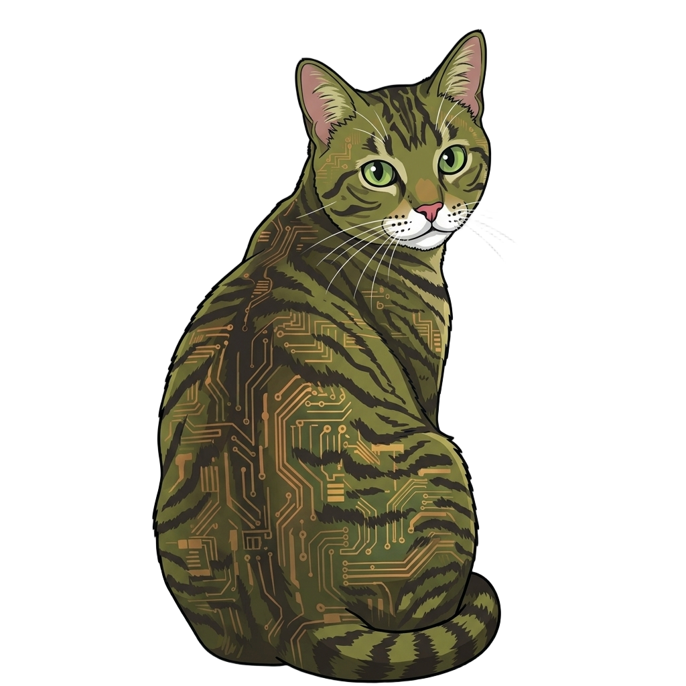

<div align="center">
  
  <h1>Felix OS</h1>
  <p><strong>A lightweight, modular, POSIX-compliant operating environment for embedded systems</strong></p>
</div>

**Felix OS** is a lightweight, modular, POSIX-compliant operating environment built for embedded systems. It bridges the gap between a compact real-time OS (or bare-metal scheduler) and a familiar Unix-like system—providing filesystems, standard C/POSIX interfaces, and an interactive command-line shell within a very small memory footprint and without requiring a hardware MMU.

---

## Philosophy: Hardware & OS Agnostic

Felix is designed around strict separation of concerns so the core OS never gets locked to a single chip or RTOS vendor:

* **Hardware Agnostic:** This repository contains pure, portable OS middleware with zero board-specific pinouts, clock setups, or vendor SDKs. Today, Felix runs on the **Microchip PolarFire SoC Discovery Kit** (64-bit RISC-V) via its companion Board Support Package ([`felix-bsp-mpfs`](https://github.com/viosca/felix-bsp-mpfs)), and is architected to port cleanly to 32-bit and 64-bit ARM and other architectures.
* **Low-Level OS Agnostic:** Core Felix subsystems talk to a thin internal Scheduler Abstraction Layer rather than calling a specific RTOS directly. FreeRTOS serves as the current scheduling backend (with optional `FreeRTOS-Plus-POSIX` threading and IPC for applications), while keeping the door open for Zephyr, ThreadX, or bare-metal backends.

---

## Core Capabilities

* **Virtual File System (VFS):** Unified directory tree (`/`, `/dev`, `/tmp` in-memory RAMFS, `/bin`, `/etc`, and `/mnt` removable storage).
* **Storage & Hotplugging:** Automatic SD/MMC card detection, MBR and GPT partition discovery, and FAT/exFAT filesystem mounting.
* **POSIX & C Runtime:** Thread-safe Newlib integration, per-process file descriptors, working directories, environment variables, and optional POSIX threads, mutexes, semaphores, message queues, and timers.
* **Interactive Shell & Tools:** Command-line shell (`flx_sh`) with line editing, history, tab completion, built-in file utilities, and Toybox support.
* **Kconfig & Built-in Verification:** Menu-driven feature configuration (`scripts/kconfig.py`) and an on-target automated test suite (`/test/all`) that scales cleanly from kilobyte-scale SRAM profiles up to full DDR builds.

---

## How Felix Is Used

Because `felix` is hardware-independent, it is not compiled as a standalone board project on its own. Instead, a **Board Support Package (BSP)** wrapper repository imports `felix` alongside the target silicon vendor's HAL, supplies the board startup and linker scripts, and builds the final firmware image.

To inspect or customize Felix OS features from a workspace:

```bash
# Launch the graphical configuration editor (Tk)
python felix/scripts/kconfig.py guiconfig

# Or launch the terminal menu editor
python felix/scripts/kconfig.py menuconfig
```

---

## Documentation (Start Here for Contributors & AI Assistants)

Detailed architectural rules and subsystem designs live in [`docs/`](docs/):

* **[Felix Golden Rules & Architectural Goals](docs/GOLDEN_RULES.md)** — **Read this first.** Defines what Felix is, strict hardware/OS quarantine boundaries, and coding guardrails for both human developers and AI coding assistants.
* **[Dynamic Loading, Shared Libraries & Configurability Design](docs/dynamic_loading_and_configurability_design.md)** — Kconfig build profiles, position-independent ELF loading, and shared library architecture.
* **[FreeRTOS+POSIX Integration Plan](docs/freertos_posix_integration_plan.md)** — How optional POSIX threading and IPC coexist with Felix's native VFS and syscall layer.

---

## Mascot & Icons

Meet **Felix** — the official mascot of Felix OS! Felix is an olive-green solder-mask tabby cat with subtle golden-copper PCB traces and IC via pads woven into his fur. Full-resolution artwork, transparent cutouts, and multi-resolution application icons (`.ico` and `.png` down to 16x16) are located in [`docs/assets/`](docs/assets/).

---

## License

See [LICENSE.md](LICENSE.md) for licensing details.
