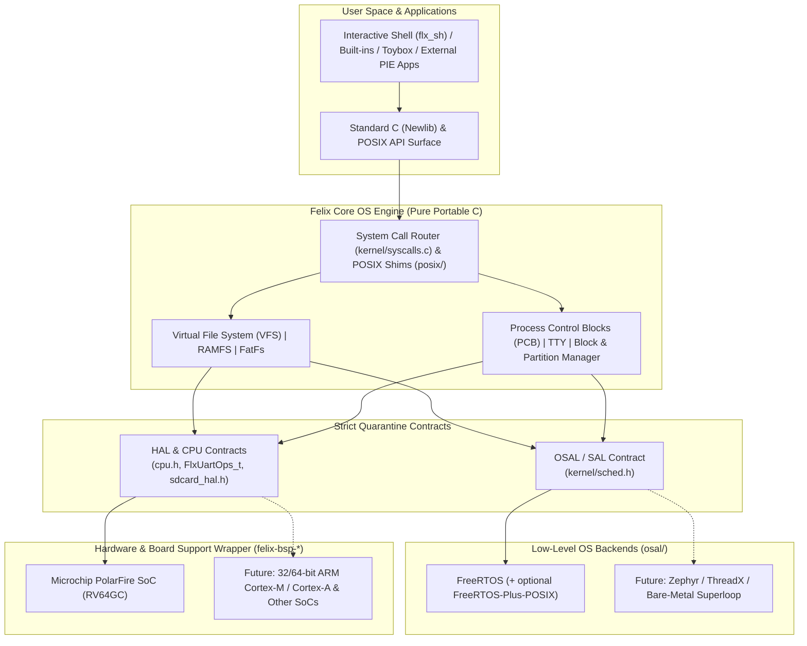

# Felix OS: Architectural Goals, Dual Agnosticism & Golden Rules

> **Purpose of This Document:** This is the canonical architectural constitution for **Felix OS**. Every human contributor and **AI coding assistant** working on Felix OS or a Board Support Package (BSP) must read and adhere to these principles before designing features, refactoring subsystems, or writing code.

---

## 1. What Felix OS Is (and What It Is Not)

**Felix OS** is a lightweight, modular, POSIX-compliant operating environment and kernel middleware engine written in portable C.

It is designed to bridge the gap between a deterministic embedded executive (such as an RTOS or bare-metal scheduler) and a full Unix-like operating system—delivering standard filesystems, process semantics, POSIX APIs, and an interactive shell within kilobytes of memory and **without requiring a hardware MMU**.

### What Felix Provides
* **Virtual File System (VFS):** A unified Unix-like namespace (`/`, `/dev`, `/tmp` RAMFS, `/bin`, `/etc`, and `/mnt` dynamic mounts via FatFs/exFAT).
* **Process & Execution Contexts (PCB):** Per-process `FlxProcPCB_t` state tracking isolated file descriptors (`fds`), working directories (`cwd`), `umask`, C-library reentrancy (`_reent`), and environment variables (`env`).
* **System Call & POSIX Layer:** A clean `sys_*` kernel boundary backing standard C/Newlib I/O, POSIX.1-2008 `*at` directory-relative operations, `termios`, `wordexp`, and optional POSIX threads/IPC (`pthread`, `semaphore`, `mqueue`, `timer`).
* **Device & Storage Frameworks:** Hardware-agnostic serial/TTY line disciplines (`flx_serial_core`), hotpluggable block device management (`blk_manager`), and 64-bit MBR/GPT partition discovery.
* **Interactive Userland & Verification:** Built-in interactive shell (`flx_sh` + `linenoise`), core utilities, Toybox integration, Kconfig build profiles, and an on-target unit test suite (`/test`).

### What Felix Is *Not*
* **Not a hardware BSP:** Felix never contains board pin multiplexing, clock-tree setup, silicon-vendor HALs, or board linker scripts.
* **Not a hardware-locked or RTOS-locked kernel:** Felix does not hardwire itself to RISC-V, ARM, FreeRTOS, or any single vendor SDK.

---

## 2. Core Architectural Goal: Dual Agnosticism

The foundational design goal of Felix OS is **Dual Agnosticism**: remaining strictly independent of both the **underlying hardware/ISA** and the **low-level scheduling OS/executive**.

1. **Low-Level OS Agnosticism:** Core Felix subsystems (`kernel/`, `fs/`, `drivers/`, `posix/`, `shell/`) depend solely on Felix's **Scheduler Abstraction Layer (SAL)** (`kernel/sched.h`), never directly on FreeRTOS or `FreeRTOS-Plus-POSIX`. Swapping the underlying RTOS requires only a new `osal/<engine>/` plugin.
2. **Hardware & ISA Agnosticism:** Core Felix subsystems interact with hardware exclusively through abstract vtable contracts (`FlxUartOps_t`, `FlxVfsOps_t`, `sdcard_hal.h`) and generic CPU primitives (`cpu.h`). Porting to a new board or CPU architecture requires an external `felix-bsp-<target>` wrapper repository—never forking Felix core.

---

## 3. Repository & Directory Quarantine Map

Contributors and AI assistants must respect what is allowed—and what is **strictly forbidden**—in each directory:

| Location | Responsibility | Strictly Forbidden |
| :--- | :--- | :--- |
| **`felix-bsp-<board>/`** *(External Wrapper Repo)* | Board startup, multi-core/hart boot, clock/DDR init, linker scripts (`.ld`), silicon vendor SDKs, concrete hardware drivers (`mss_serial_port.c`, `sdcard_hal.c`). | Modifying core Felix kernel logic in-place through board-specific `#ifdef` hacks. |
| **`felix/kernel/`** | VFS core, `syscalls.c`, `process.c` (PCB), `tty.c`, `blk_manager.c`, GPT/MBR parsers, `sched.h` contract. | `#include "FreeRTOS.h"`, `#include <pthread.h>`, vendor HAL headers, inline `__asm__`, CSRs. |
| **`felix/fs/`** | Filesystem drivers (`ramfs`, `fatfs` VFS adapter) and static `rootfs/` hierarchy (`/bin`, `/dev`, `/etc`, `/mnt`, `/tmp`, `/test`). | Direct hardware register access or RTOS-specific task calls. |
| **`felix/drivers/`** | Generic, hardware-agnostic driver frameworks (e.g., `flx_serial_core.c` ring-buffer & TTY bottom-half). | Silicon-specific register structs or vendor SDK calls (route via ops tables!). |
| **`felix/posix/`** | Portable user-space POSIX shims (`unistd.c`, `dirent.c`, `fcntl.c`, `wordexp.c`, `execvp.c`) calling `sys_*`. | Bypassing `sys_*` to poke hardware or RTOS internals directly. |
| **`felix/shell/`** | Interactive shell (`flx_sh`), command parsing, history, and tab completion. | Architecture-specific or RTOS-vendor-specific calls. |
| **`felix/arch/<isa>/`** | CPU-specific primitives implementing `cpu.h` (IRQ mask/unmask, memory barriers, WFI, architectural timers). | Board-specific peripheral drivers or RTOS policy. |
| **`felix/osal/<rtos>/`** | **The RTOS Quarantine.** Implements `struct sched_operations` (`freertos_sched.c`), RTOS hooks, and optional POSIX bridges (`freertos_posix.c`). | Leaking RTOS headers outside `osal/<rtos>/` unless explicitly requested via optional userland POSIX headers. |
| **`felix/external/`** | Upstream third-party submodules (`FreeRTOS-Kernel`, `FreeRTOS-Plus-POSIX`, `optparse`, `linenoise`, `toybox`, `fatfs`). | Ad-hoc edits to upstream vendor code when a thin Felix wrapper or portable header can solve the problem cleanly. |

---

## 4. The Eight Golden Rules

### Rule 1: Strict BSP / Umbrella Separation
`felix` is a pure OS middleware repository. It must have **zero knowledge** of specific development boards, pinouts, FPGA designs, interrupt controller memory maps, or silicon-vendor bootloaders.
* Board startup, linker scripts, IDE launch configs, and vendor HALs live in the external BSP repository (e.g., `felix-bsp-mpfs`), which consumes `felix` cleanly as a linked module/submodule.

### Rule 2: The SAL Quarantine (Low-Level OS Agnosticism)
Core Felix code (`kernel/`, `fs/`, `drivers/`, `posix/`, `shell/`) must **never** include `<FreeRTOS.h>`, `<task.h>`, `<semphr.h>`, or call RTOS-native functions (`xTaskCreate`, `vTaskDelay`) directly.
* All kernel thread creation, termination, yielding, sleeping, Thread-Local Storage (TLS), critical sections, and ISR-to-task semaphores **must** go through `kernel/sched.h` (`sched_thread_create`, `sched_sem_take`, `sched_get_tls`, etc.).

### Rule 3: Layered & Optional Userland POSIX
External POSIX threading/IPC libraries (such as `FreeRTOS-Plus-POSIX` providing `pthread_*`, `sem_*`, `mq_*`, `timer_*`) are **userland/application personalities**, not kernel foundations.
* Kernel boot, daemons (`blk_manager`), VFS, and the interactive shell must **not** hard-depend on `pthread_create()`.
* If `CONFIG_FELIX_FREERTOS_PLUS_POSIX` is disabled in Kconfig (e.g., on a memory-constrained microcontroller or minimal SRAM profile), Felix OS must still compile cleanly, boot, mount storage, and run its shell.

### Rule 4: Contract-Driven Hardware Abstraction (Vtable HALs)
Subsystems never call hardware drivers directly. Every class of hardware connects to Felix via an explicit C vtable (`ops` struct):
* **Serial / UART:** Board drivers register an opaque instance + `FlxUartOps_t` (`felix_register_uart()`) and notify Felix from interrupts using generic upcalls (`flx_serial_isr_rx_byte()`, `flx_serial_isr_tx_pop()`, `flx_serial_isr_tx_done()`).
* **Block Storage:** Board SD/MMC drivers implement the `sdcard_hal.h` contract; `blk_manager` and FatFs never touch controller registers.
* **Filesystems & `/dev` Nodes:** Everything in VFS routes through `FlxVfsOps_t`.

### Rule 5: Zero ISA Intrinsics Outside `arch/`
Inline assembly (`__asm__`), CPU control/status registers (CSRs), and ISA-specific intrinsics are forbidden in `kernel/`, `fs/`, `posix/`, `drivers/`, and `shell/`.
* CPU-level operations (interrupt save/restore, memory fences, idle/`wfi`) belong exclusively behind `arch/<isa>/include/cpu.h`.

### Rule 6: 32-Bit / 64-Bit & No-MMU Hygiene
Felix targets everything from 32-bit no-MMU Cortex-M/RV32 microcontrollers to 64-bit Cortex-A/RV64 application processors:
* **Pointer & Integer Discipline:** Always use `<stdint.h>` (`uintptr_t`, `intptr_t`, `size_t`, `ptrdiff_t`, `uint32_t`, `uint64_t`). Never assume `sizeof(void*) == 8`, `sizeof(int) == sizeof(void*)`, or `sizeof(long) == sizeof(void*)` (note: LP64 vs ILP32!).
* **64-Bit Storage Addressing:** File sizes, seek positions, and LBA block addresses must use `off_t` / `uint64_t` so 32-bit MCUs can read/write >4 GB partitions (FAT32/exFAT/GPT) without overflow.
* **No-MMU Execution Compatibility:** Dynamic loading and external binaries must use Position-Independent Executable (`-fPIE -pie`) conventions so programs execute identically in flat physical SRAM/DDR (No-MMU) and paged virtual memory (MMU).

### Rule 7: Preserve Upstream Submodule Integrity
Third-party repositories in `felix/external/` should remain clean and upgradable.
* Avoid modifying upstream submodule sources to work around header collisions or selective compilation.
* Instead, use Felix's header interception pattern (`felix/include/` with `#include_next`) and single-translation-unit bridges in `felix/osal/` (such as `osal/freertos/freertos_posix.c` and `FreeRTOS_POSIX_portable.h`) gated by Kconfig.

### Rule 8: Kconfig Scalability & Self-Verification
* **Configurable Footprint:** Every non-trivial subsystem, driver framework, and test suite must be controlled via `felix/Kconfig` (`autoconf.h`) with accurate `depends on` clauses so minimal builds pay zero RAM/ROM penalty for disabled features.
* **On-Target Regression Testing:** Every new kernel, VFS, or POSIX capability should include verification assertions in `felix/fs/rootfs/test/` using the header-only `flx_test.h` framework, ensuring `/test/all` remains the definitive hardware health check.

---

## 5. Multi-Core & Heterogeneous (AMP) Guidelines

Target SoCs often combine heterogeneous CPU cores (for example, deterministic real-time monitor/control cores alongside application cores running Felix OS).
* **No Single-Core Global Assumptions:** Per-task and per-core execution state (such as the active `FlxProcPCB_t *`) must be retrieved via Thread-Local / Hart-Local Storage (`sched_get_tls()`), never unprotected single-core globals.
* **Hardware-Agnostic Inter-Core IPC:** Cross-core messaging must use portable lockless ring buffers (`kernel/ring_buffer.h`) in shared memory paired with an abstract doorbell/IPI contract—never hardcoded interrupt controller registers inside core kernel code.

---

## 6. Pre-Flight Checklist for Contributors & AI Assistants

Before proposing, generating, or committing code, verify every item below:

- [ ] **Right Repo?** Does this code belong in portable `felix`, or is it board/silicon-specific code that belongs in `felix-bsp-<board>`?
- [ ] **OS Agnostic?** Does core code use `kernel/sched.h` (SAL) rather than `#include "FreeRTOS.h"` or `pthread_*`?
- [ ] **POSIX Optional?** Does the build still succeed if `CONFIG_FELIX_FREERTOS_PLUS_POSIX` or optional subsystems are disabled in Kconfig?
- [ ] **Hardware Agnostic?** Are peripherals accessed strictly via ops structs/HAL contracts with zero vendor header leaks or inline `__asm__`?
- [ ] **32/64-Bit Safe?** Are pointers stored in `void *` / `uintptr_t` (never `uint32_t` or `int`), and are storage offsets 64-bit?
- [ ] **Memory Safe for Constrained Profiles?** Will this fit and compile cleanly in tight SRAM/LIM targets (e.g., avoiding huge stack buffers and gating optional code via Kconfig)?
- [ ] **Tested & Documented?** Are existing comments preserved, Kconfig dependencies accurate, and `/test/*` suites updated where appropriate?
